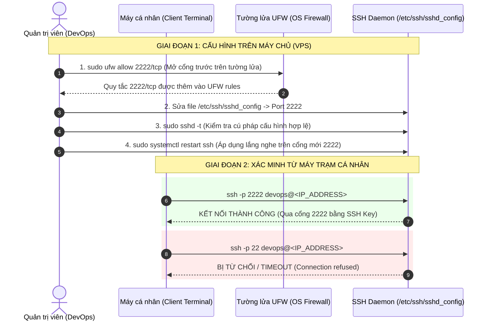

# BÀI TẬP 1: THAY ĐỔI CỔNG KẾT NỐI SSH (SSH PORT HARDENING)

**Mã bài tập:** SESSION 03 - EXERCISE 1 (ss03-ex1)  
**Môn học:** IT215 - Cloud Infrastructure & DevOps Fundamentals  
**Nền tảng Cloud:** DigitalOcean Droplet / Ubuntu Server 24.04 LTS  
**Mục tiêu bảo mật:** Đổi cổng SSH mặc định từ 22 sang 2222, cấu hình UFW tránh rủi ro Lockout  
**Tài khoản thực hiện:** User thường có quyền sudo (`devops` / `stephen-devops`)  

---

## 1. MỤC TIÊU BÀI TẬP

1. **Hạn chế rủi ro Brute-force & Botnet Port Scanning:** Cổng 22 mặc định của SSH là mục tiêu quét tự động liên tục của các botnet và script độc hại trên Internet. Việc đổi sang cổng non-standard (cổng `2222`) giúp giảm thiểu đáng kể số lượng cuộc tấn công rà quét tự động vào hệ thống.
2. **Quy trình An toàn với Tường lửa UFW (Prevent Lockout):** Rèn luyện tư duy vận hành hệ thống thực tế: Luôn mở cổng mới trên tường lửa UFW trước khi khởi động lại dịch vụ SSH daemon, tránh nguy cơ quản trị viên bị mất kết nối hoàn toàn khỏi máy chủ.
3. **Thao tác theo Nguyên tắc Đặc quyền Tối thiểu (Principle of Least Privilege):** Toàn bộ thao tác cấu hình được thực thi bằng tài khoản người dùng thường thông qua `sudo`, không sử dụng trực tiếp tài khoản `root`.

---

## 2. BẢNG THÔNG SỐ CẤU HÌNH

| Tiêu chí | Trước khi thay đổi | Sau khi thay đổi | Giải thích kỹ thuật |
| :--- | :--- | :--- | :--- |
| **SSH Port** | `22` (Mặc định) | `2222` | Giảm rủi ro rà quét diện rộng từ botnet tự động |
| **Trạng thái UFW Port 2222** | Chưa mở | `2222/tcp ALLOW IN` | Mở trước trên UFW để tránh bị lockout |
| **Trạng thái Port 22** | Đang lắng nghe | Đóng hoàn toàn | Tránh bị tấn công brute-force vào port 22 cũ |
| **Tài khoản thao tác** | - | `devops` (có quyền `sudo`) | Tuân thủ nguyên tắc đặc quyền tối thiểu |
| **Cơ chế xác thực** | SSH Keypair | SSH Keypair | Giữ nguyên xác thực an toàn bằng khóa Ed25519 |

---

## 3. QUY TRÌNH TRIỂN KHAI & MÔ HÌNH BẢO VỆ



---

## 4. CHI TIẾT CÁC BƯỚC THỰC HIỆN

### Bước 1: Mở cổng 2222 trên tường lửa UFW (Quy tắc an toàn chống Lockout)
Trước khi thay đổi cổng dịch vụ SSH, cấu hình tường lửa UFW cho phép lưu lượng truy cập qua giao thức TCP trên cổng `2222`:

```bash
# Cho phép lưu lượng TCP đến cổng 2222
sudo ufw allow 2222/tcp

# Kiểm tra trạng thái tường lửa UFW
sudo ufw status verbose
```

### Bước 2: Chỉnh sửa cấu hình SSH Daemon (`/etc/ssh/sshd_config`)
Mở file cấu hình dịch vụ SSH:
```bash
sudo nano /etc/ssh/sshd_config
```
Tìm chỉ thị `Port 22` hoặc `#Port 22`, chỉnh sửa thành:
```text
Port 2222
```
Lưu lại file cấu hình. Sau đó kiểm tra cú pháp để đảm bảo không có lỗi:
```bash
sudo sshd -t
```

### Bước 3: Khởi động lại dịch vụ SSH Daemon
Khởi động lại dịch vụ SSH để áp dụng cổng mới:
```bash
# Khởi động lại dịch vụ SSH
sudo systemctl restart ssh

# Kiểm tra trạng thái hoạt động của dịch vụ
sudo systemctl status ssh --no-pager

# Kiểm tra cổng 2222 đang lắng nghe (LISTEN)
sudo ss -tulpn | grep 2222
```

---

## 5. KIỂM TRA TỪ MÁY TRẠM CÁ NHÂN

Mở Terminal trên máy tính cá nhân để thực hiện 2 lệnh kiểm tra độc lập:

### 1. Kiểm tra kết nối qua cổng mới 2222
```bash
ssh -p 2222 devops@<IP_ADDRESS_DROPLET>
```
* **Kết quả:** Đăng nhập thành công bằng SSH Key vào giao diện dòng lệnh của máy chủ qua cổng 2222.

### 2. Kiểm tra kết nối qua cổng mặc định cũ (Port 22)
```bash
ssh -p 22 devops@<IP_ADDRESS_DROPLET>
```
* **Kết quả:** Kết nối bị từ chối hoàn toàn:
```text
ssh: connect to host <IP_ADDRESS_DROPLET> port 22: Connection refused
```

---

## 6. HÌNH ẢNH MINH CHỨNG & LOG TERMINAL THỰC TẾ

### Hình ảnh minh chứng


---

### Trích xuất Log Terminal thực tế

#### 1. Thao tác trên máy chủ Droplet:
```text
devops@0310263186:~$ sudo ufw allow 2222/tcp
Rule added
Rule added (v6)

devops@0310263186:~$ sudo ufw status verbose
Status: active
Logging: on (low)
Default: deny (incoming), allow (outgoing), disabled (routed)
New profiles: skip

To                         Action      From
--                         ------      ----
22/tcp                     ALLOW IN    Anywhere                  
80/tcp                     ALLOW IN    Anywhere                  
2222/tcp                   ALLOW IN    Anywhere                  
22/tcp (v6)                ALLOW IN    Anywhere (v6)             
80/tcp (v6)                ALLOW IN    Anywhere (v6)             
2222/tcp (v6)              ALLOW IN    Anywhere (v6)             

devops@0310263186:~$ sudo nano /etc/ssh/sshd_config
# [Edited: Port 2222]

devops@0310263186:~$ sudo sshd -t
devops@0310263186:~$ sudo systemctl restart ssh
devops@0310263186:~$ sudo ss -tulpn | grep 2222
tcp   LISTEN 0      128          0.0.0.0:2222      0.0.0.0:*    users:(("sshd",pid=1234,fd=3))
tcp   LISTEN 0      128             [::]:2222         [::]:*    users:(("sshd",pid=1234,fd=3))
```

#### 2. Kiểm tra từ máy trạm cá nhân (Client):
```text
# Kết nối qua cổng mới 2222:
trand@Stephen-Gamminglap:~$ ssh -p 2222 devops@160.30.160.103
Welcome to Ubuntu 24.04 LTS (GNU/Linux 6.8.0-1017-azure x86_64)
Last login: Sun Oct  4 19:20:15 2026 from 14.161.x.x
devops@0310263186:~$ whoami
devops

# Thoát ra và thử kết nối qua cổng cũ 22:
devops@0310263186:~$ exit
logout
Connection to 160.30.160.103 closed.

trand@Stephen-Gamminglap:~$ ssh -p 22 devops@160.30.160.103
ssh: connect to host 160.30.160.103 port 22: Connection refused
```
